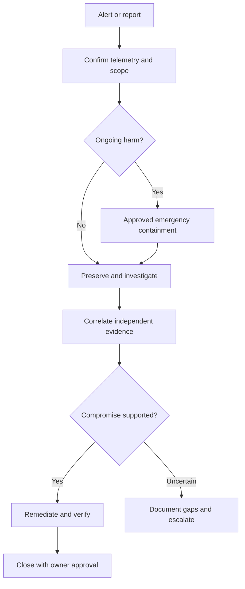
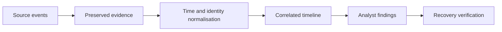

# Diagram Patterns

These examples define a consistent technical diagram style for RootGuard.

## Investigation flow

This diagram is a conceptual decision aid. Incident command may prioritise containment over complete collection when risk is urgent.

## Evidence pipeline

**Accessibility:** Always provide a text explanation of what the diagram demonstrates. GitBook Mermaid rendering and mobile behaviour must be checked on the published site.

[Design system](README.md)
