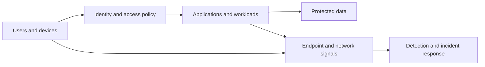

# Enterprise Security Architecture Assessment

**Audience:** Security architects, engineering leads, SOC/IR leads and governance stakeholders.  
**Status:** Architecture review methodology; implementation controls must be validated locally.

## 1. Define architecture context

Record in-scope identities, endpoints, workloads, data stores, networks, SaaS, cloud tenants, locations and external trust relationships. Document business objectives, critical services, regulatory requirements, current architecture and explicit exclusions. Capture architecture decision owners.

## 2. Draw trust boundaries

The diagram is a conceptual logical architecture, not an implementation topology. Identify privileged management planes, service identities, hybrid synchronization, network segmentation, cross-tenant relationships and resilience boundaries in the actual estate.

## 3. Assess control design and operational evidence

| Domain | Questions to answer | Evidence |
| --- | --- | --- |
| Identity | Is access lifecycle controlled? Are privileged/session risks treated independently of MFA coverage? | Conditional Access policy, PIM, sign-in and audit records |
| Endpoint | Is enforcement consistent and does alerting reach responders? | EDR deployment, configuration, sensor-health inventory |
| Network | Are sensitive flows constrained and observable? | Firewall/segmentation policy, network telemetry |
| Cloud and workload | Are roles, secrets and external trust minimized? | Role assignments, workload identities, configuration audit |
| Data | Are critical data flows classified, monitored and recoverable? | Data maps, access control, backup restoration tests |
| Detection | Do material threats have data sources, validated logic and responders? | Use cases, test results, coverage and tuning register |
| Incident recovery | Are containment and restore operations tested and assigned? | IR plan, exercises, restore evidence and runbooks |

## 4. Record an architecture decision

Use the [architecture decision template](../contributing/templates/architecture-decision.md), identifying proposed changes, options, trade-offs, assumptions, accountable owners and verification evidence.

## 5. Prioritise remediation

Rank findings by critical-service exposure, threat likelihood, exploit path, compensating controls and change complexity. Distinguish design gaps from implementation gaps and telemetry blind spots. Avoid scoring solely by the number of tools deployed.

## 6. Validate controls

Specify the test method, responsible team, success/failure signals, evidence retention and review cadence for each accepted change. Governance attestations and feature enablement alone do not prove control effectiveness.

## Deliverable checklist

- Current/target logical diagrams and trust boundaries
- Inventory and critical-service dependencies
- Threat scenarios and controls mapped to evidence
- Decision records and prioritized changes
- Testing criteria and accountable technical owners
- Residual risks and business approvals
